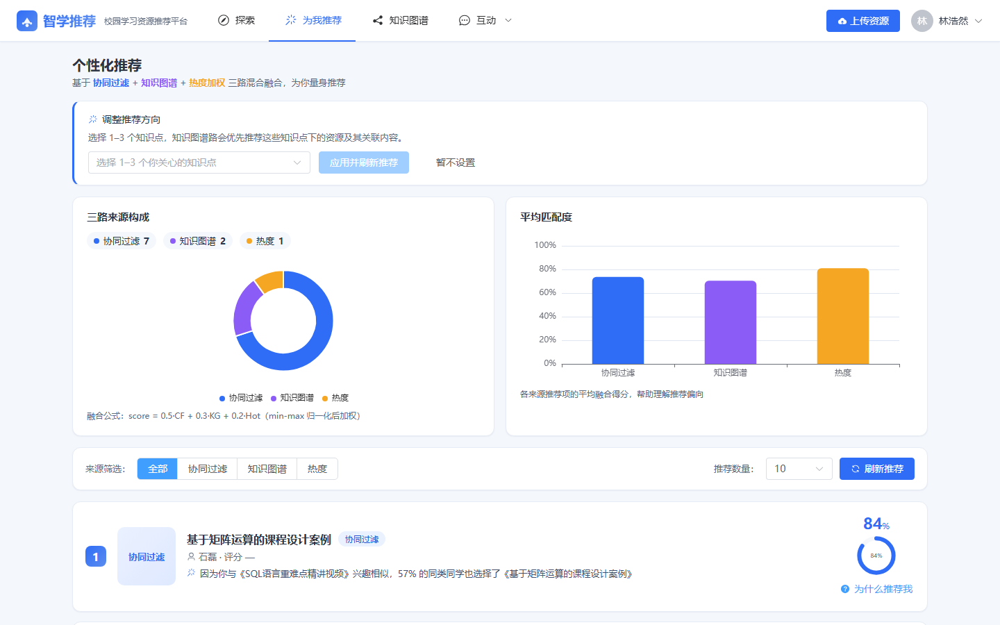
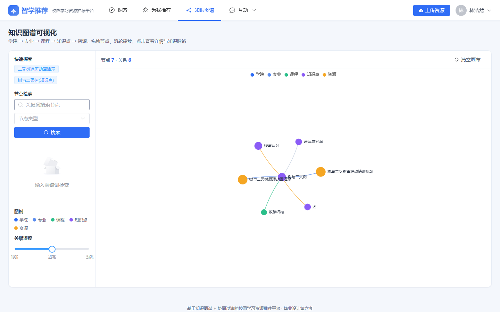

# 基于知识图谱与协同过滤的校园学习资源推荐平台

面向校园学习资源的推荐系统。把知识图谱的语义关系和协同过滤的行为相似度合到一起排序，每条推荐都给出“为什么推给你”。

前后端分离，分学生端和管理端。本科毕业设计项目。


## 为什么做这个

学校里的学习资源散在群文件、网盘、课程平台，学生找不到，老师也不知道哪些资源真的被用过。常见的推荐做法是用协同过滤，但这个场景有两个绕不过去的问题：

- **冷启动**：新生没有任何收藏、下载、评分，协同过滤算不出相似用户，只能退回“全站最热”。
- **不可解释**：算出分数就完了，学生不知道为什么推这个，点开的意愿低。

这个系统用知识图谱补上语义关系（资源属于哪个知识点、知识点之间有什么先修和关联），用三路融合加可解释理由来应对上面两点。

## 功能

学生端

- 资源广场：按学院、类型、关键词筛选，支持排序和分页
- 个性化推荐：三路融合排序，显示来源标签（协同过滤 / 知识图谱 / 热度）、融合得分和推荐理由
- 冷启动引导：新用户选 1 到 3 个知识点作为兴趣种子，推荐立刻从“全是热门”切换成知识图谱路径
- 知识图谱浏览：力导向图拖拽缩放，点节点看知识点详情和关联资源
- 资源互助、问答广场、资源上传、个人中心（收藏 / 下载 / 上传记录）

管理端

- 资源审核：通过后自动同步到知识图谱
- 图谱运维：节点和关系的增删、MySQL 到 Neo4j 的全量同步
- 学科数据管理：学院、专业、课程、资源分类
- 数据大屏：用户与资源规模、增长趋势、分类占比、知识点热度、学院排行
- 用户管控：学生账号的启用、停用、软删除

## 技术栈

| 层 | 选型 |
|---|---|
| 前端 | Vue 3.5 + Vite 5.4 + Element Plus 2.8 + Pinia + Vue Router 4 |
| 图表 | ECharts 5.5（图谱、大屏），ogl 1.0（登录页极光着色器） |
| 后端 | Spring Boot 3.2.5 + MyBatis-Plus 3.5.7 + JWT |
| 业务库 | MySQL 8（18 张表） |
| 图数据库 | Neo4j 2026.08.1（316 节点、358 关系） |

注意：项目 `pom.xml` 的 `java.version` 是 17，用 JDK 17 及以上都能编译；本机实际用 JDK 26 跑。Neo4j 2026 反过来，必须用 JDK 21 启动。

## 推荐算法

三路候选各自打分，min-max 归一化后加权：

```
score = 0.5 * CF + 0.3 * KG + 0.2 * Hot
```

- **CF**：基于收藏、下载、评分三张行为表构建 ItemCF 共现矩阵，取与用户历史资源最相似的候选
- **KG**：取用户历史资源所属知识点，沿 Neo4j 的多跳关系（同课程、先修、相关）汇聚关联资源，按跳数衰减
- **Hot**：按资源热度取全局热门，兜底用

排序后按得分最高的那一路作为“主导来源”，套对应的话术生成理由，例如“因为你与《SQL 语言重难点精讲视频》兴趣相似，57% 的同学也选择了《基于矩阵运算的课程设计案例》”。

冷启动时前两路没有输入，用户勾选知识点后，系统把这些知识点当作兴趣种子：直接命中的资源给最高分，一跳关联的资源按距离衰减，写进 KG 那一路的候选集，下游的归一化和融合逻辑不用改。



## 快速开始

### 环境要求

| 组件 | 版本 |
|---|---|
| JDK（后端） | 17 及以上，本机 26 |
| JDK（Neo4j） | 21 |
| Maven | 3.9 及以上，或使用项目内 `tools/apache-maven-3.9.9` |
| Node.js | 18 及以上，本机 22 |
| MySQL | 8.x |
| Neo4j | 2026.08.1 社区版 |

### 步骤

1. 建库并导入数据

```sql
CREATE DATABASE campus_recommend DEFAULT CHARACTER SET utf8mb4;
```

按编号执行 `data/` 下的 SQL（01 建表、02 学科数据、04 资源、05 用户、06 行为、07 社区内容）。每个文件的行数和编号规则见 `data/README.md`。

2. 导入图谱

在 Neo4j Browser 里执行 `data/neo4j_init.cypher`。默认密码改成 `neo4j123`，与后端配置保持一致。

3. 配置密码

`application.yml` 里数据库、Neo4j、JWT 的密钥都从环境变量读，不再写死。启动前设置三个变量：

```bash
set MYSQL_PASSWORD=你的MySQL密码
set NEO4J_PASSWORD=你的Neo4j密码
set JWT_SECRET=一段随机长字符串
```

Windows 上更省事：把 `backend/local-env.example.cmd` 复制成 `backend/local-env.cmd` 填上真实值。这个文件已被 `.gitignore` 忽略，不会进仓库；`一键启动.bat` 会自动加载它。

4. 启动后端

```bash
cd backend
mvn -DskipTests clean package
java -jar target/campus-recommend-1.0.0.jar
```

5. 启动前端

```bash
cd frontend
npm install
npm run dev
```

浏览器打开终端里 `Local:` 显示的地址，默认是 `http://localhost:3000`。如果 3000 被别的程序占用，Vite 会顺延到 3001，以终端输出为准。

Windows 上也可以双击根目录的 `一键启动.bat`，它会依次检查 MySQL、Neo4j、后端、前端并打印实际访问地址。注意脚本里的 jar 路径和 Neo4j 路径是按开发机写的（`D:\jaeger\...`），换机器需要改。

### 默认账号

| 角色 | 账号 | 密码 |
|---|---|---|
| 超级管理员 | `admin` | `admin123` |
| 普通管理员 | `manager` | `admin123` |
| 学生 | `linhaoran` | `123456` |
| 零行为学生（演示冷启动） | `shaoziqian` | `123456` |

## 界面

知识图谱页，左侧按类型筛选，右侧点节点看详情：



管理端数据大屏：


登录页：


## 项目结构

```
├── backend/                 Spring Boot 服务
│   └── src/main/java/com/campus/recommend/
│       ├── controller/      13 个 Controller，75 个端点
│       ├── service/         推荐、图谱、审核、用户等业务
│       └── entity/          实体与 Mapper
├── frontend/                Vue 3 应用
│   └── src/
│       ├── views/           22 个路由页面（student 与 admin 两组）
│       ├── components/     通用组件（骨架屏、状态块、资源卡片）
│       └── styles/         设计令牌
├── data/                    建表 SQL、种子数据、Neo4j 初始化脚本
├── docs/screenshots/        README 用的截图
├── 一键启动.bat / 停止服务.bat
└── 00 ~ 10 号设计文档
```

## 文档

| 文档 | 内容 |
|---|---|
| `00-项目规划与分工.md` | 选题要求、技术选型、里程碑、文档地图 |
| `01-数据库设计.md` | 18 张表的字段与 DDL |
| `02-知识图谱设计.md` | 节点、关系、Cypher、同步机制 |
| `03-接口契约.md` | 75 个接口的入参出参 |
| `04-部署与启动指南.md` | 部署、日常启动、故障排查 |
| `05-内网穿透部署指南.md` | 用 cpolar 做公网演示 |
| `06-UI设计方案.md` | 设计令牌、信息架构、设计取舍 |
| `07-前端优化验收报告.md` | 三批前端改造的量化验收 |
| `08-前端3D动效优化方案.md` | 动效审计与方案对比 |
| `09-前端3D动效实施记录.md` | 极光、图谱 Hero、后处理的实现 |
| `10-系统完整性与Bug排查记录.md` | 4 个缺陷的根因与修复 |
| `data/README.md` | 种子数据的执行顺序与编号规则 |

## 已知限制

- 没有在线演示。系统依赖 MySQL 和 Neo4j，必须本地跑起来才能用，截图只覆盖主要页面。
- 一键启动脚本带开发机路径，换机器要改三处：jar 路径、Neo4j 目录、JDK 21 目录。
- 软删除的用户仍可登录。删除接口把状态置 2，但登录逻辑只拦状态 0，补一个 `status != 1` 的判断即可，目前未修。
- 移动端只做了基础适配（页面改单列），管理端表格在小屏上仍是横向滚动。

## License

毕业设计作品，仅供学习参考。
